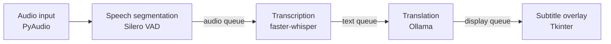

# StreamGloss

Live subtitles in Traditional Chinese for English live streams and videos, running entirely on your own machine.

StreamGloss listens to an audio input, transcribes speech with Whisper, translates each sentence with a local LLM through Ollama, and shows the result in an always-on-top subtitle bar above the stream. No audio or text leaves the computer.

## How it works



Each stage runs in its own thread and hands work to the next through bounded queues, so a slow translation never blocks audio capture.

- **Segmentation** — Silero VAD splits the stream into utterances at pauses, with padding and a maximum length so long monologues are still cut into readable lines.
- **Transcription** — faster-whisper with a configurable model size, beam search and an initial prompt for domain vocabulary.
- **Translation** — a prompt for Taiwan Traditional Chinese, plus a cleaner that strips filler such as "Here is the translation:" and code fences from the model output.
- **Overlay** — a translucent subtitle bar showing the Chinese line with the English source underneath; size, colour and position are configurable.
- **Shutdown** — on Ctrl+C each worker thread is stopped in order and the Whisper model is released.

## Requirements

- Python 3
- [Ollama](https://ollama.com) with a model pulled, for example `ollama pull llama3`
- An NVIDIA GPU with CUDA for real-time transcription (CPU works with a smaller model)
- PortAudio for PyAudio (`brew install portaudio` on macOS)
- A loopback or virtual audio device if you want to capture system audio rather than a microphone

## Usage

```bash
pip install -r requirements.txt
python main.py [input_device_index] [--no-gui]
```

- `input_device_index` — the PyAudio input device to capture from
- `--no-gui` — print translations to the console instead of showing the overlay

## Configuration

All settings live in [`streamgloss/config.py`](streamgloss/config.py) (`AppConfig`):

| Group | Examples |
| --- | --- |
| Whisper | `whisper_model_size`, `whisper_device`, `whisper_compute_type`, `whisper_language`, `whisper_initial_prompt` |
| VAD | `vad_threshold`, `vad_min_silence_ms`, `max_utterance_seconds` |
| Ollama | `ollama_model`, `ollama_temperature` |
| Overlay | `overlay_alpha`, `overlay_tw_font_size`, `overlay_width_ratio`, `overlay_bg_color` |

## Project structure

```
main.py                        entry point and CLI flags
streamgloss/
  config.py                    AppConfig
  pipeline.py                  wires the workers and handles shutdown
  audio_ingestion.py           PyAudio capture and VAD segmentation
  transcription_worker.py      faster-whisper consumer
  translation_worker.py        Ollama consumer and prompt
  translation_cleaner.py       post-processing of model output
  subtitle_overlay.py          Tkinter subtitle window
```

## License

[Apache-2.0](LICENSE)
