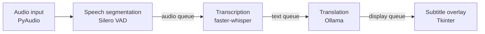

# StreamGloss

**English** · [中文](#中文)

Live subtitles in Traditional Chinese for English live streams and videos, running entirely on your own machine.

StreamGloss listens to an audio input, transcribes speech with Whisper, translates each sentence with a local LLM through Ollama, and shows the result in an always-on-top subtitle bar above the stream. No audio or text leaves the computer.

## How it works



Each stage runs in its own thread and hands work to the next through bounded queues. When a later stage falls behind, new segments are dropped after a short wait instead of letting the subtitles lag further and further behind the stream.

- **Segmentation** — Silero VAD splits the stream into utterances at pauses, with padding and a maximum length so long monologues are still cut into readable lines.
- **Transcription** — faster-whisper with a configurable model size, beam search and an initial prompt for domain vocabulary.
- **Translation** — a prompt for Taiwan Traditional Chinese, plus a cleaner that strips filler such as "Here is the translation:" and code fences from the model output.
- **Overlay** — a translucent subtitle bar showing the Chinese line with the English source underneath; size, colour and position are configurable.
- **Shutdown** — on Ctrl+C each worker thread is stopped in order and the Whisper model is released.

## Requirements

- Python 3
- [Ollama](https://ollama.com) with a model pulled, for example `ollama pull llama3`
- An NVIDIA GPU with CUDA for real-time transcription (CPU works with a smaller model)
- PortAudio for PyAudio (`brew install portaudio` on macOS)
- A loopback or virtual audio device if you want to capture system audio rather than a microphone

## Usage

```bash
pip install -r requirements.txt
python main.py [input_device_index] [--no-gui]
```

- `input_device_index` — the PyAudio input device to capture from
- `--no-gui` — print translations to the console instead of showing the overlay

## Configuration

All settings live in [`streamgloss/config.py`](streamgloss/config.py) (`AppConfig`):

| Group | Examples |
| --- | --- |
| Whisper | `whisper_model_size`, `whisper_device`, `whisper_compute_type`, `whisper_language`, `whisper_initial_prompt` |
| VAD | `vad_threshold`, `vad_min_silence_ms`, `max_utterance_seconds` |
| Ollama | `ollama_model`, `ollama_temperature` |
| Overlay | `overlay_alpha`, `overlay_tw_font_size`, `overlay_width_ratio`, `overlay_bg_color` |

## Project structure

```
main.py                        entry point and CLI flags
streamgloss/
  config.py                    AppConfig
  pipeline.py                  wires the workers and handles shutdown
  audio_ingestion.py           PyAudio capture and VAD segmentation
  transcription_worker.py      faster-whisper consumer
  translation_worker.py        Ollama consumer and prompt
  translation_cleaner.py       post-processing of model output
  subtitle_overlay.py          Tkinter subtitle window
```

## License

[Apache-2.0](LICENSE)

---

## 中文

英文直播與影片的即時繁體中文字幕，全程於本機執行。

StreamGloss 擷取音訊輸入，以 Whisper 辨識語音，透過 Ollama 的本地 LLM 逐句翻譯，並將結果顯示於置頂的字幕列。音訊與文字皆不會離開本機。

### 運作方式

各階段在獨立執行緒中執行，以有上限的佇列傳遞工作。當後段處理不及時，新片段會在短暫等待後捨棄，避免字幕與畫面的延遲持續累積。

- **斷句** — Silero VAD 依停頓切分語句，並設有前後緩衝與最大長度，長段發言也能切成易讀的字幕。
- **語音辨識** — faster-whisper，可設定模型大小、beam search 與領域詞彙提示。
- **翻譯** — 針對台灣繁體中文的 prompt，並清除模型輸出中的「以下是翻譯」等贅詞與 code fence。
- **字幕列** — 半透明字幕列，上方顯示中文、下方附英文原文，大小、顏色與位置皆可調整。
- **結束** — 按下 Ctrl+C 後依序停止各執行緒並釋放 Whisper 模型。

### 需求

- Python 3
- [Ollama](https://ollama.com) 並下載模型，例如 `ollama pull llama3`
- 支援 CUDA 的 NVIDIA 顯示卡以達到即時辨識（CPU 可改用較小的模型）
- PyAudio 所需的 PortAudio（macOS：`brew install portaudio`）
- 若要擷取系統音訊而非麥克風，需要 loopback 或虛擬音訊裝置

### 使用方式

```bash
pip install -r requirements.txt
python main.py [input_device_index] [--no-gui]
```

- `input_device_index` — 要擷取的 PyAudio 輸入裝置
- `--no-gui` — 不顯示字幕列，改將翻譯輸出至終端機

所有設定集中於 [`streamgloss/config.py`](streamgloss/config.py) 的 `AppConfig`，包含 Whisper、VAD、Ollama 與字幕列等參數。

### 授權

[Apache-2.0](LICENSE)
